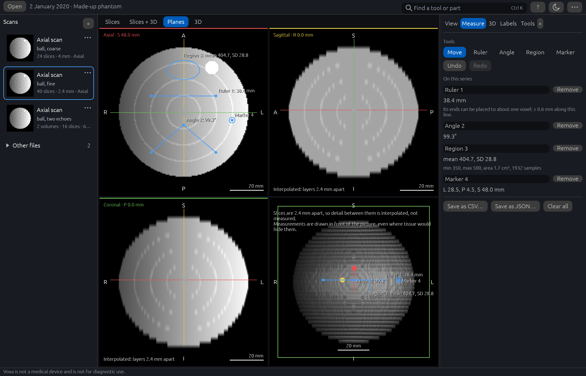
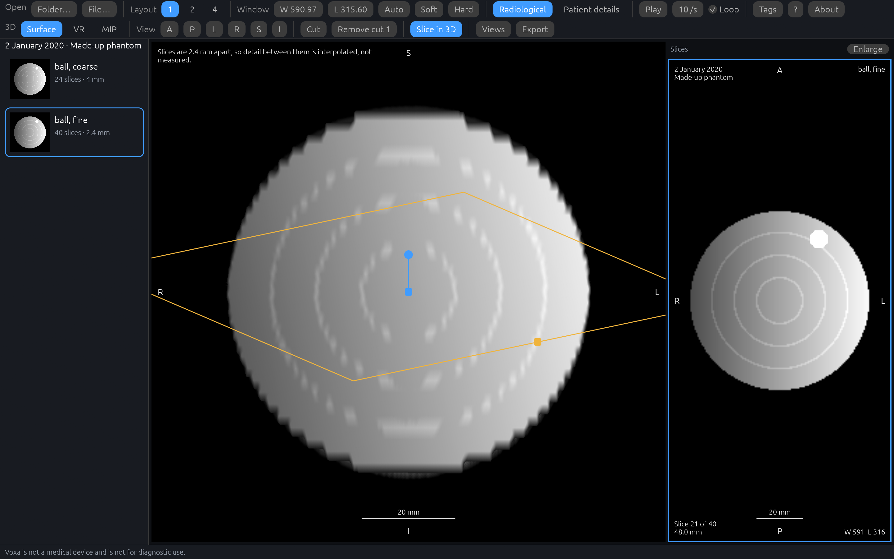
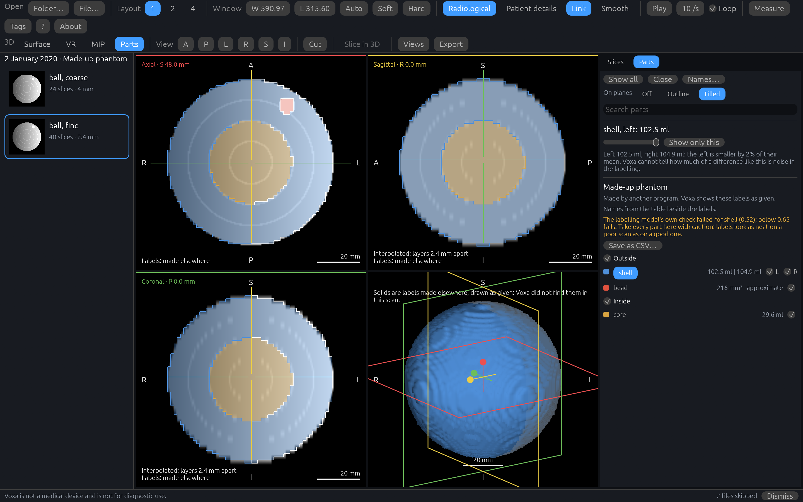
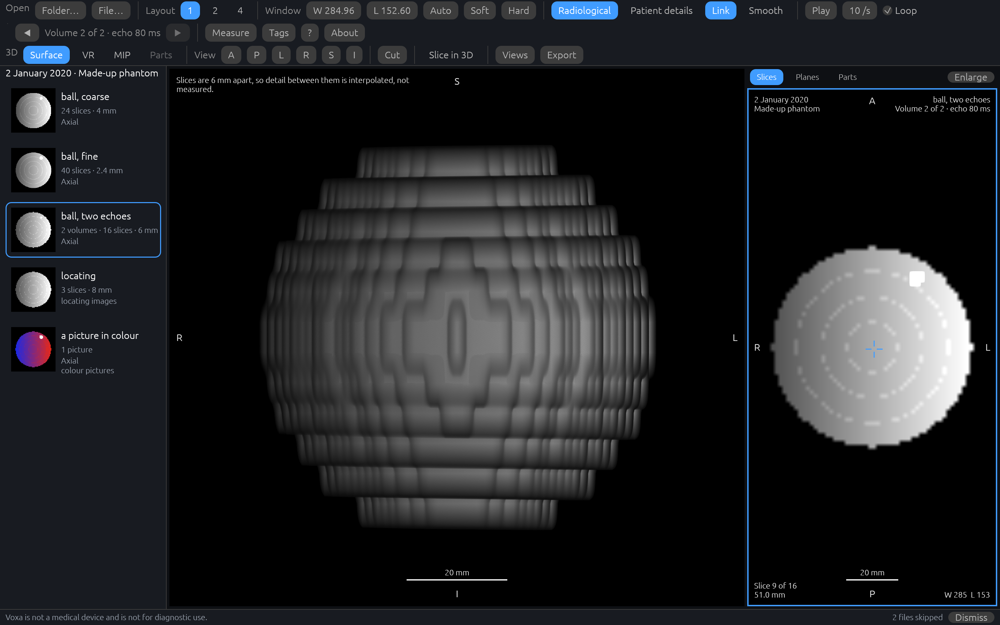

# Voxa

Voxa is a desktop viewer for MRI scan exports, written in Rust. It opens a folder, a zip or a
`DICOMDIR`, lists the studies and series inside and says what kind each is, and shows any series
as a stack of slices with correct orientation, contrast controls, overlays, tag inspection and
cine playback; shows the series being looked at as a 3D volume that can be turned, cut open and
saved as a picture; shows axial, coronal and sagittal planes through any point of it, on which
lengths, angles and regions can be measured and points marked; and shows the parts of the head
that have been labelled on a scan, over the planes and as solids in 3D, with a list of them and
their volumes. It runs on your own computer and makes no network connections.

**Voxa is not a medical device and is not for diagnostic use.**



The pictures show a made-up study that Voxa's own example writes, not a scan of anyone. Above:
a ball in its axial, sagittal and coronal planes and in 3D, with a ruler, an angle, a region and
a marker measured on it, and the slice through its middle beside them. There are more
[below](#a-closer-look).

## Download and run

1. Open the [Releases](../../releases) page and, under **Assets** for the newest release,
   download `voxa-<version>-windows-x64.zip`.
2. Unzip it: right-click it, choose **Extract All…** and pick a folder of your own, such as one
   in Documents. It holds one folder, `voxa-<version>`, with `voxa.exe`, a short `README.txt`,
   the licences and notices, `MODELS.md` (how to set up labelling) and the changelog.
3. Start `voxa.exe`. Open a scan with **Folder…** or **File…** in the toolbar (a folder of
   DICOM files, a zip of them, or a `DICOMDIR`), or drop it on the window.

**Windows may warn you the first time.** Voxa is not signed with a code-signing certificate, so
Microsoft Defender SmartScreen may say "Windows protected your PC" and give the publisher as
unknown. If the zip came from this repository's Releases page, choose **More info** and then
**Run anyway**.

From a command prompt, `voxa.exe PATH` opens a scan at once, and `voxa.exe PATH --labels FILE`
opens it with labels another program made for it. `voxa.exe --help` says the rest, in a small
window.

### Removing Voxa

Voxa has no installer. To remove it, close it and delete the `voxa-<version>` folder you
unzipped, with any `runtime` and `models` folders you put in it. Then delete the two folders
where it keeps things between runs ([below](#what-voxa-keeps-on-your-computer)): type
`%APPDATA%\Voxa` into File Explorer's address bar and delete that folder, then do the same for
`%LOCALAPPDATA%\Voxa`.

## System requirements

- 64-bit Windows 10 or 11.
- A graphics device with DirectX 12 or Vulkan. If Voxa cannot open its window, it says why in a
  message and closes.
- To label a brain scan, which is optional: two sets of files Voxa does not come with, and a
  good deal of memory. [docs/models.md](docs/models.md) says what and how much.

Voxa has been tried on Windows 11 with an NVIDIA discrete graphics card and with Intel
integrated graphics. Windows 10 and other graphics devices have not been tried. Linux and macOS
are not yet offered.

## What Voxa keeps on your computer

Voxa makes no network connections. It sends nothing anywhere, collects nothing and has no
telemetry. What it keeps between runs stays on this computer, in two folders of its own.

**Settings**, in `%APPDATA%\Voxa\config`:

| File | What it holds |
|---|---|
| `preferences.json` | The window's size, how many viewports, the **Radiological** and **Link** switches, and how labels are drawn over the planes. Nothing about any scan. |
| `views.json` | The views of the 3D scene you saved, for each series. |
| `annotations.json` | Your markers, rulers, angles and regions for each series, with the names you gave them. |
| `choices.json` | What you chose for labelling under **Options**, with the two folders you named, if any. |
| `labels\` | Labelling results kept to be shown again: for each series, a label file and the table of its parts' names. |

Each series is filed under a 16-digit hash of its identifier, not under the identifier, and
nothing in these files names a patient. Still, a kept label file is a map of someone's head and
an annotation holds whatever name you typed, so treat this folder as you would the scans.
Labelling results are kept unless you switch off **Keep results on this computer** under
**Options** in the Parts tab, and **Delete**, beside a kept result, removes it.

**The log**, `%LOCALAPPDATA%\Voxa\data\voxa.log`, is for finding out why something went wrong.
It says when Voxa started, its version and the system, which graphics device it draws with, how
many studies, series and skipped files an export held, the messages Voxa showed (a message whose
words may name a file is logged by its kind alone), and where in Voxa's code a crash happened.
It never holds a patient's name, identifier or date, a value from a file, or a path. Once it
passes 1 MB it is cut back to its newest 512 KB the next time Voxa starts. The **About** window
shows where it is, with a button that copies the path.

Apart from these, Voxa writes a file only when you save one, in the place you choose: a picture
or a turntable of the 3D scene (which holds the picture and nothing else from the scan),
measurements, the list of parts, or labels.

**Patient details are hidden.** Each time Voxa starts, the patient's name and identifier are
left out of the viewports, and in the tag browser the value of every tag in the patient group
(0010) is hidden and cannot be found by searching. **Patient details** in the toolbar shows them
until you switch it off or close Voxa. The study's date and description are shown either way.

ONNX Runtime, which runs the labelling networks, reports usage (not images) in Microsoft's
Windows builds unless told not to. Voxa tells it not to before it asks anything else of it.

## Getting help and reporting a fault

Report a fault, or ask for something Voxa does not do, in the repository's
[Issues](../../issues); a form asks for what is needed.

**Never attach a scan, a scan export, a label file made from a scan, or a screenshot that shows
patient details, and never paste tag values.** Anyone can read an issue. Describe what you saw
in words. Even with **Patient details** off, each viewport's corner shows the study's date and
description.

Please include:

- **Voxa's version**, which the **About** window shows.
- **Windows' version**: press Windows+R, type `winver` and press Enter.
- **The graphics device.** The log names the one Voxa draws with; Device Manager lists it under
  Display adapters.
- **`voxa.log`**, which the **About** window locates. It holds nothing about a patient and none
  of your file names, but read it before you paste it.
- What you did, what happened, and what you expected.

A security vulnerability is reported privately, never in an issue: see
[SECURITY.md](SECURITY.md). To work on Voxa, see [CONTRIBUTING.md](CONTRIBUTING.md).

## A closer look



The same ball turned and cut open in the 3D scene.



The same ball with the made-up labels that come with it, tinted over the three planes and drawn
as solids in 3D, with the list of its parts. The left half of its shell is selected, and the
list sets it against the right half. The two halves were drawn equal: the 2% between them is
where the labels' own coarse voxels happen to fall, which is the kind of difference Voxa says
it cannot tell from noise.



An export holds more than plain stacks of slices, and the list says what each series is. Here
the made-up study also holds a series of two volumes of the ball, taken at two echo times,
listed once and shown on its second volume, as the toolbar and the viewport say; three
locating images in three planes; and a picture in colour, which is shown in its own colours.

## Labelling a brain scan

Voxa shows two kinds of labels, and says which is which wherever it draws them. Labels made by
another program are read from a file and shown as made elsewhere; Voxa does not vouch for
them. Labels of the structures of a brain, and of the areas of its cortex, Voxa makes itself
on this computer when asked, with SynthSeg 2.0's networks run through ONNX Runtime and, on
Windows, DirectML. A label made by a model is a guess that looks certain, so each one comes
with the model's own check of its work, which is said first when it fails.

To label a scan, open it, choose the Parts tab and press **Label this scan**. That needs two
things Voxa does not come with: the three files of ONNX Runtime with DirectML in a `runtime`
folder beside `voxa.exe`, and a model folder made from SynthSeg's files in a `models` folder
beside it (or the folders named under **Options**). Voxa ships no network and no runtime, and
downloads neither: [docs/models.md](docs/models.md), which comes in the zip as `MODELS.md`, says
where they come from, how to make the model folder, and why. Without them Voxa starts and does
everything else, and the button says what is missing.

## Status

Version 0.5.0, which finishes the fourth milestone: 0.4.0 showed labels from files, and 0.5.0
labels a brain scan inside Voxa. It also reads more kinds of MRI export. What it does and what
it does not yet do are in the [changelog](CHANGELOG.md); how it was checked is in
[docs/acceptance-0.5.0.md](docs/acceptance-0.5.0.md), and for the reading of more kinds of
export in [docs/acceptance-any-mri.md](docs/acceptance-any-mri.md). The design and the plan for
every milestone are in [docs/superpowers](docs/superpowers), and why labelling is built as it
is in [docs/adr/0006-voxa-runs-a-labelling-model.md](docs/adr/0006-voxa-runs-a-labelling-model.md).

## Building from source

This part is for people who want to build Voxa or work on it. [CONTRIBUTING.md](CONTRIBUTING.md)
says how changes are made.

### Build and run

Voxa needs the Rust toolchain named in `rust-toolchain.toml`; `rustup` installs it on first use.

```bash
cargo run --release -p voxa-app -- path/to/export.zip
```

To show labels made for that scan by another program, name the label file too, or open it from
the Parts tab, or drop it on the window:

```bash
cargo run --release -p voxa-app -- path/to/export.zip --labels path/to/labels.nii.gz
```

To label a brain scan in a build of your own, put the `runtime` and `models` folders beside the
executable the build makes, or name them under **Options**, as
[docs/models.md](docs/models.md) says.

```bash
cargo xtask dist
```

builds the release program and makes `target/dist/voxa-<version>-windows-x64.zip`, the zip the
Releases page offers.

### Check your work

```bash
cargo xtask check
```

runs, in order: formatting, lints, the 400-line limit on source files, that
`THIRD-PARTY-NOTICES.txt` is current (`cargo xtask notices` rewrites it), every test, licence and
advisory checks (`cargo deny`), and the documentation build. Every test program runs even when
one fails, so all failures are reported together; any other failing step stops it there.
`cargo deny` is installed with `cargo install --locked cargo-deny`.

```bash
cargo xtask coverage
```

measures line coverage of `voxa-core`, `voxa-dicom`, `voxa-volume`, `voxa-labels`,
`voxa-models` and `voxa-segment` and fails below 80% on any of them. The two files that need
the runtime or a graphics card, `runtime.rs` and `cards.rs`, are left out of the count. It
needs `cargo install --locked cargo-llvm-cov`.

```bash
VOXA_MODELS=path/to/model-folder VOXA_RUNTIME=path/to/runtime-folder cargo xtask check-models
```

holds the labelling of a made-up head against SynthSeg's own answers, on the processor and on
each graphics card, with the real networks. It runs the tests that the other two leave out,
which need a model folder and the runtime; without both variables it does nothing and says so.
`cargo xtask check` needs neither on the machine. It passes in full: the `zip` crate is at
version 9, past three advisories about extracting archives (Voxa never extracts one), and
`deny.toml` sets aside three notices that crates Voxa uses only for accessibility on Linux are
no longer maintained, each with its reason. It has been run on Windows only.

### Layout

| Crate | Purpose |
|---|---|
| `voxa-core` | Data model, typed coordinate spaces, errors |
| `voxa-dicom` | Sources (folder, zip, DICOMDIR), header indexing, pixel decoding |
| `voxa-volume` | Volumes from series, sampling and lines of sight, planes through a volume, measuring, histograms and automatic window/level |
| `voxa-labels` | Label volumes (NIfTI) and their tables of names, read and written; which part lies at a point |
| `voxa-models` | The networks: finding and checking a model folder, running a network through ONNX Runtime, the graphics cards and what a run needs of the computer |
| `voxa-segment` | SynthSeg's own steps around its networks: preparing a scan, the steps between networks, tidying the answer into labels with the model's verdict |
| `voxa-render` | GPU drawing of slices, of volumes, of planes through them and of labelled parts; the 3D camera |
| `voxa-app` | The application, `voxa.exe`: interface, state, background work |
| `xtask` | Project tasks (`check`, `coverage`, `check-models`, `dist`) |

Beside the crates, `tools/synthseg-to-onnx` turns SynthSeg's files into a model folder (Python,
run once by a person; cargo neither builds nor runs it), `tools/golden` makes the arrays that
SynthSeg's own program gives for small made-up volumes, which the tests hold Voxa's steps to,
and `tools/fixtures` makes a small made-up JPEG 2000 picture for the decoding test.

Crates depend only downward: core, then dicom, volume, labels and models, then segment and
render, then app. See [docs/architecture.md](docs/architecture.md) and the decision records in
[docs/adr](docs/adr).

Scan data never belongs in this repository: tests build synthetic images.

### Trying it without a scan

```
cargo run -p voxa-app --example write_phantom -- phantom
cargo run -p voxa-app -- phantom
cargo run -p voxa-app -- phantom --labels phantom/labels/labels.nii.gz
```

The first command writes a small made-up study (a ball, brighter towards the patient's left, with
a bead near the front, with a series of two volumes of it at two echo times, three locating
images and a picture in colour) to the folder `phantom`; the second opens it. The third opens it
with the made-up labels the first command wrote beside it: the ball's shell in two halves, its
core and the bead. Voxa then says it skipped two files, which are the labels and their table:
they are not part of the scan. Setting the environment variable `VOXA_CAPTURE` to a `.png` path
makes Voxa save one picture of its own window and close, which is how the pictures in the
documentation are made. `VOXA_CAPTURE_SERIES` names the series to show by words from its
description, and the word `stepped` in `VOXA_CAPTURE_SHOW` shows the next volume of a series
that holds several.

The ball has no brain in it, so there is nothing for the labelling model to find. For something
with a brain's shape that is nobody's, the model folder's `check` folder holds a made-up head,
painted from a label map that comes with SynthSeg, and `write_phantom` can write it as a study:

```
cargo run -p voxa-app --example write_phantom -- head path/to/model-folder/check head
cargo run -p voxa-app --example write_phantom -- head path/to/model-folder/check head-whole whole
```

The second puts the head in the middle of a grid of air as large as a scan of a whole head
(176 x 256 x 256 voxels). With `VOXA_MODELS` and `VOXA_RUNTIME` set as above,

```
cargo run --release -p voxa-app --example check_labelling -- head [standard|robust] [no-areas]
```

labels the largest series that has a 3D view, with no window, on every place Voxa would try
(each discrete graphics card, then the processor, whole and then cut to the head) and prints
for each the number of voxels the networks were given, the place, the seconds, the number of
parts and whether the model's own check passed, and nothing else.

## Licence

Licensed under either of [Apache License, Version 2.0](LICENSE-APACHE) or
[MIT license](LICENSE-MIT) at your option. Contributions are accepted under the same terms.

Voxa is built on other people's libraries, each under its own licence; `cargo deny check` holds
them to the licences listed in [deny.toml](deny.toml). The licence and notice texts of every
package built into the program are in [THIRD-PARTY-NOTICES.txt](THIRD-PARTY-NOTICES.txt), which
`cargo xtask notices` writes. [NOTICE](NOTICE) holds Voxa's own notice and SynthSeg's
attribution. Both come in the zip. This software is based in part on the work of the
Independent JPEG Group.

Voxa's labelling steps (`voxa-segment`) are a port to Rust of SynthSeg's own code, Copyright 2020
Benjamin Billot, under the Apache License 2.0. [NOTICE](NOTICE) carries the attribution and says
how the port differs.

Labelling uses three things that are not in this repository, each under its own licence:

- **ONNX Runtime** (Microsoft), which runs the networks, under the MIT licence. Voxa loads it
  from files beside the executable through the `ort` crate (MIT or Apache-2.0); it is not built
  into Voxa.
- **DirectML** (Microsoft), which lets ONNX Runtime use a graphics card on Windows, under
  Microsoft's own licence: it may be passed on inside an application for use on Windows, it is
  not open source, and its notices must stay with it. Windows 11 has a copy of its own, and
  Voxa carries none.
- **SynthSeg 2.0** (Billot et al.), the model. Its code is Apache 2.0. Its trained networks
  carry no licence statement of their own and are distributed with FreeSurfer, under
  FreeSurfer's terms, so Voxa ships none and fetches none: you get SynthSeg's files under
  the terms they come with and turn them into a model folder on your own computer.

The typefaces in the interface come with the `egui` library: Ubuntu Light (Ubuntu Font Licence
1.0), Hack (MIT, and the Bitstream Vera licence for its Bitstream Vera glyphs), Noto Emoji (SIL
Open Font Licence 1.1) and emoji-icon-font (MIT). No other font files are in this repository.
