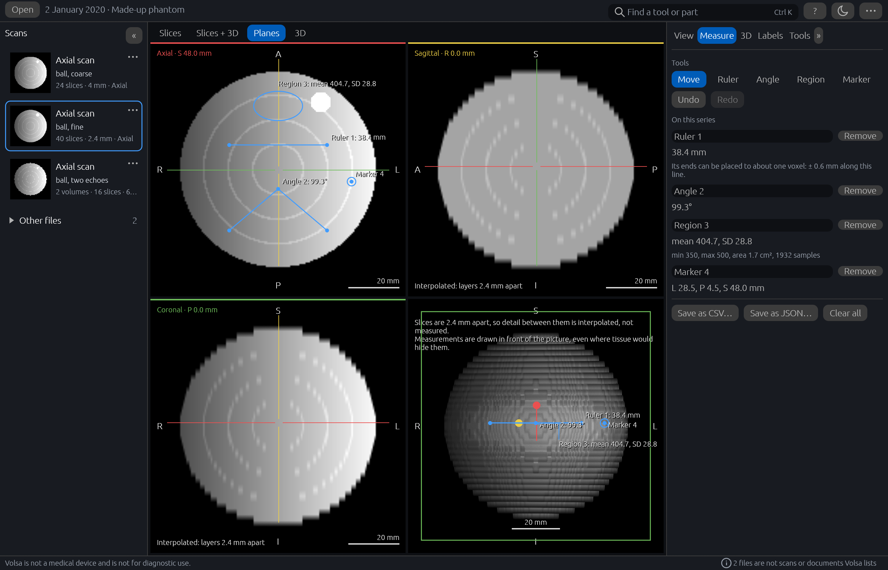

# Volsa

Volsa is a desktop viewer for MRI and CT scan exports, and other DICOM files at a basic level,
for 64-bit Windows. It opens a folder, a zip or a `DICOMDIR` and shows each series as slices, as
three planes and as a volume in 3D that can be turned and cut open; lengths, angles and regions
can be measured on it, and the parts of a brain can be labelled. It runs on your own computer and
makes no network connections.

**Volsa is not a medical device and is not for diagnostic use.** What it is for, and what it is
not for, is in [docs/intended-use.md](docs/intended-use.md).

The picture shows a made-up study that Volsa's own example writes, not a scan of anyone.

## Download and start

1. From the [Releases](../../releases) page, under **Assets** for the newest release, download
   `volsa-<version>-windows-x64.zip`. Its SHA-256 is beside it, in the file ending `.sha256`.
2. Unzip it into a folder of your own (right-click, **Extract All…**). Volsa has no installer.
3. Start `volsa.exe` in the `volsa-<version>` folder, and open a scan with **Open** at the top
   left, or drop a folder, a zip or a `DICOMDIR` on the window.

Volsa is not signed with a code-signing certificate, so Windows may say "Windows protected your
PC" the first time. If the zip came from this repository's Releases page, choose **More info**
and then **Run anyway**. [Download and run](../../wiki/Download-and-run) says how to check the
SHA-256 and how to get round the window.

**Needs:** 64-bit Windows 10 or 11, and a graphics device with DirectX 12 or Vulkan. Labelling a
brain scan, which is optional, needs more: see [Labelling a brain scan](../../wiki/Labelling-a-brain-scan).

## More in the wiki

[Download and run](../../wiki/Download-and-run) ·
[Removing Volsa](../../wiki/Removing-Volsa) ·
[System requirements](../../wiki/System-requirements) ·
[What Volsa keeps on your computer](../../wiki/What-Volsa-keeps-on-your-computer) ·
[Patient details and privacy](../../wiki/Patient-details-and-privacy) ·
[Getting help and reporting a fault](../../wiki/Getting-help-and-reporting-a-fault) ·
[A closer look](../../wiki/A-closer-look) ·
[Labelling a brain scan](../../wiki/Labelling-a-brain-scan) ·
[Status](../../wiki/Status) ·
[Building from source](../../wiki/Building-from-source) ·
[Trying it without a scan](../../wiki/Trying-it-without-a-scan) ·
[Licences and credits](../../wiki/Licences-and-credits)

The wiki's pages are kept in this repository, in [wiki/](wiki), and checked with the code.

**Never attach a scan, a scan export or a screenshot that shows patient details to an issue**:
anyone can read it. Report a fault in [Issues](../../issues), and a security vulnerability
privately, as [SECURITY.md](SECURITY.md) says. To work on Volsa, see
[CONTRIBUTING.md](CONTRIBUTING.md). What changed in each version is in the
[changelog](CHANGELOG.md).

## Licence

Licensed under either of [Apache License, Version 2.0](LICENSE-APACHE) or
[MIT license](LICENSE-MIT) at your option. The notices of the libraries Volsa is built on are in
[THIRD-PARTY-NOTICES.txt](THIRD-PARTY-NOTICES.txt), and SynthSeg's attribution in
[NOTICE](NOTICE); [Licences and credits](../../wiki/Licences-and-credits) says more.
