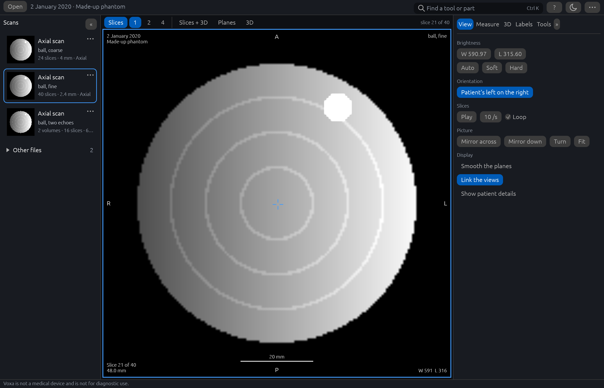

# Voxa

Voxa is a desktop viewer for MRI and CT scan exports, and other DICOM files at a basic level,
written in Rust. It opens a folder, a zip or a
`DICOMDIR`, lists the studies and series inside and says what kind each is, and shows any series
as a stack of slices with correct orientation, contrast controls, overlays, tag inspection and
cine playback; shows the series being looked at as a 3D volume that can be turned, cut open and
saved as a picture; shows axial, coronal and sagittal planes through any point of it, on which
lengths, angles and regions can be measured and points marked; and shows the parts of the head
that have been labelled on a scan, over the planes and as solids in 3D, with a list of them and
their volumes. It runs on your own computer and makes no network connections.

**Voxa is not a medical device and is not for diagnostic use.** What it is for, and what it is
not for, is in [docs/intended-use.md](docs/intended-use.md).


The pictures show a made-up study that Voxa's own example writes, not a scan of anyone. Above:
at the left, the rail of scans, a card for each; in the middle, **Planes**, a ball in its axial,
sagittal and coronal planes and in 3D, with a ruler, an angle, a region and a marker measured on
it; and at the right the **Measure** tab, listing those four with their values. There are more
[below](#a-closer-look).

## Download and run

1. Open the [Releases](../../releases) page and, under **Assets** for the newest release,
   download `voxa-<version>-windows-x64.zip`.
2. Unzip it: right-click it, choose **Extract All…** and pick a folder of your own, such as one
   in Documents. It holds one folder, `voxa-<version>`, with `voxa.exe`, a short `README.txt`,
   `INTENDED-USE.txt` (what Voxa is for and what it is not for), the licences and notices,
   `MODELS.md` (how to set up labelling), the changelog, and a `runtime` folder with ONNX
   Runtime, which labelling uses.
3. Start `voxa.exe`. Open a scan with **Open** at the top left and then **Folder…** or **Zip
   file or DICOMDIR…** (a folder of DICOM files, a zip of them, or a `DICOMDIR`), or drop it on
   the window.

**Windows may warn you the first time.** Voxa is not signed with a code-signing certificate, so
Microsoft Defender SmartScreen may say "Windows protected your PC" and give the publisher as
unknown. If the zip came from this repository's Releases page, choose **More info** and then
**Run anyway**.

From a command prompt, `voxa.exe PATH` opens a scan at once, and `voxa.exe PATH --labels FILE`
opens it with labels another program made for it. `voxa.exe --help` says the rest, in a small
window.

Voxa opens at a size that fits your screen, and its window can be made as small as 640 by 480
at your display's scale. The window has a bar across the top (**Open**, the study's name and
date, the search box, help, the theme and a menu, **⋯**), the rail of scans down the left, the
pictures in the middle and, at the right, a panel of tabs: **View**, **Measure**, **3D**,
**Labels** and **Tools**. Along the bottom are the disclaimer and the notices. The search box,
which Ctrl+K or `/` opens, finds the actions by their names and by other words for them, and
also the parts of open labels, the scans of the export and the help topics. **?** opens the
help: seven short topics, then every key.

An export opens on its slices. The strip above the pictures arranges them: **Slices** (with one,
two or four viewports), **Slices + 3D**, **Planes** (the three planes and the 3D view, two by
two) or **3D** alone. **B** folds the rail of scans to a strip, and **P** the tab panel, as do
the **«** at the top of the rail and the **»** at the top of the panel; a click on a strip
opens it again. The rail starts folded in a window under 960 points across; under 760 both
fold, and no more than one is open at a time, so that the pictures keep their room. The edge of the rail and the edge
of the panel can be dragged to give either more of the width. **F11** is full screen, and
**Size** in the **⋯** menu draws the words and buttons larger or smaller, as do Ctrl+= and
Ctrl+- (Ctrl+0 puts them back). Voxa remembers the window's size, the size of the words and
buttons, how wide you dragged the rail and the panel, which of them you folded, which tab is
open and the theme (light, dark or the system's); full screen, which scans you opened, what you
typed in the search box and whether patient details are shown start afresh each time.

An export can hold more than scans. The rail lists locating images, scanned pages, reports and
other files under **Other files**, which a click opens. A report opens as text in the middle of
the window, headed "Shown as text. The original report is the reference.", and its dates are
written in words. A PDF stored in the export is not shown, since Voxa has no PDF reader and
starts no other program; **Save a copy as PDF…** writes a copy where you choose. Another kind of
file is named, with its kind in words, and its tags can be shown.

### Removing Voxa

Voxa has no installer. To remove it, close it and delete the `voxa-<version>` folder you
unzipped, with the `models` folder in it, if you made one. Then delete the two folders
where it keeps things between runs ([below](#what-voxa-keeps-on-your-computer)): type
`%APPDATA%\Voxa` into File Explorer's address bar and delete that folder, then do the same for
`%LOCALAPPDATA%\Voxa`.

## System requirements

- 64-bit Windows 10 or 11.
- A graphics device with DirectX 12 or Vulkan. If Voxa cannot open its window, it says why in a
  message and closes.
- To label a brain scan, which is optional: a model folder made from files Voxa does not come
  with, Microsoft's Visual C++ 2015-2022 x64 redistributable, and a good deal of memory.
  [docs/models.md](docs/models.md) says what and how much.

Voxa has been tried on Windows 11 with an NVIDIA discrete graphics card and with Intel
integrated graphics. Windows 10 and other graphics devices have not been tried. Linux and macOS
are not yet offered.

## What Voxa keeps on your computer

Voxa makes no network connections. It sends nothing anywhere, collects nothing and has no
telemetry. What it keeps between runs stays on this computer, in two folders of its own.

**Settings**, in `%APPDATA%\Voxa\config`:

| File | What it holds |
|---|---|
| `preferences.json` | The window's size, the size of the interface, how wide the rail of scans and the tab panel are, whether you folded either, which tab is open, the theme, how many viewports, the **Patient's left on the right** and **Link the views** switches, and how labels are drawn over the planes. Nothing about any scan. |

`%APPDATA%` is the roaming part of your Windows profile, which a managed network may copy to
its servers, so it holds nothing else.

**What comes of your scans, and the log**, in `%LOCALAPPDATA%\Voxa\data`, which stays on this
computer:

| File | What it holds |
|---|---|
| `views.json` | The views of the 3D scene you saved, for each series. |
| `annotations.json` | Your markers, rulers, angles and regions for each series, with the names you gave them. Voxa 0.6.0 reads this file only as it wrote it; see below. |
| `choices.json` | What you chose for labelling under **Options**, with the two folders you named, if any. |
| `labels\` | Labelling results kept to be shown again: for each series, a label file and the table of its parts' names. |
| `voxa.log` | The log, below. |

Each series is filed under a 16-digit hash of its identifier, not under the identifier, and
nothing in these files names a patient. Still, a kept label file is a map of someone's head and
an annotation holds whatever name you typed, so treat this folder as you would the scans.
Labelling results are kept unless you switch off **Keep results on this computer** under
**Options** in the Tools tab, and **Delete**, beside a kept result, removes it.

Voxa 0.5.0 and earlier kept the views, annotations, choices and labelling results in
`%APPDATA%\Voxa\config`. The first time a newer Voxa starts, it moves them to
`%LOCALAPPDATA%\Voxa\data`, each file whole; a file that is already there is not written over,
and the old one is left where it was. The log says what was moved and what was left.

**The log**, `%LOCALAPPDATA%\Voxa\data\voxa.log`, is for finding out why something went wrong.
It says when Voxa started, its version and the system, which graphics device it draws with, how
many studies, series and skipped files an export held, the messages Voxa showed (a message whose
words may name a file is logged by its kind alone), and where a crash happened. It never holds a
patient's name, identifier or date, a value from a file, or the name of any of your files. A
crash is logged by the place in the source code where it happened: a file and line in Voxa's own
code or in a library's. For a library that place can be a path on the computer Voxa was built
on, which for the program in a download is not yours, so its log holds no path on your
computer; for a Voxa you built yourself, it can be a path on your own. Once the log passes 1 MB
it is cut back to its newest 512 KB the next time Voxa starts. The **About** window shows where
it is, with a button that copies the path.

Apart from these, Voxa writes a file only when you save one, in the place you choose: a picture
or a turntable of the 3D scene (which holds the picture and nothing else from the scan),
measurements, the list of parts, labels, or a copy of a PDF from the export. Every table Voxa
saves (CSV) has a column, `notice`, that says "Voxa is not a medical device and is not for
diagnostic use." on every line, so the sentence goes wherever a line is copied, sorted or
filtered. The table of measurements ends with one more column, `scale`: `patient` where the
files say where the slices lie, `pixel spacing` where the millimetres come from the picture's
own pixel spacing alone. Measurements saved as JSON say the same in `scale` and carry the
sentence as `notice`. The table of parts also says on every line which model made the labels
(`model`: the model Voxa ran, "made by another program", or "not said" when the labels name no
model) and how the model's own check of its work went (`model_check`: `passed`, `failed`, or
`not given`).

**Measurements and Voxa 0.6.0.** A measurement made in a picture's own pixel spacing (a scan with
a pixel spacing but no position) is kept in a newer form of `annotations.json` (version 2) that
0.6.0 does not read: 0.6.0 shows no measurements for it and, the first time it saves one, sets
the file aside as `annotations.json.unread`, which no version reads back. A file holding only
measurements in the patient's millimetres is written as 0.6.0 wrote it (version 1).

**Patient details are hidden.** Each time Voxa starts, the patient's name and identifier are
left out of the rail of scans, the viewports, the titles of documents and reports, and Voxa's
notices. In a report's text they are shown as `[hidden]`, and a report item that holds a name
shows as "Name hidden". The **DICOM tags** window (**Show the file's tags**, in the menu of a
scan's card in the rail, or found by the search box) hides, and cannot find by searching, the
values of these tags, and only these:

- every tag in the patient group, 0010;
- every private tag, which is any in a group of odd number, since what a maker keeps there is
  not said;
- and this list: the accession number; the institution's name, address and department; the
  referring physician's name, address and telephone numbers; the physicians of record; the
  performing, reading, requesting and scheduled performing physicians; the operators; the
  station's name, the performed station's name and the performed location; the device's serial
  number; the admission ID; the placer order number; the requested procedure ID; and the
  scheduled and performed procedure step IDs.

The window says how many values it has hidden. A sequence, a tag that holds other tags, is shown
only as the number of items in it. **Show patient details** in the View tab shows the hidden
values until you switch it off or close Voxa.

**A name written some other way inside a report's own text** (with an initial, a title, another
spelling, or a surname alone) cannot be found reliably and may show; an identifier under four
letters or digits is not looked for, so that it cannot change a number. When Voxa has replaced
something in a report it says so under the report's heading.

**Every other value stays shown**, and some of them can still identify a scan or lead to the
person in it: dates and times, unique identifiers (UIDs), the study ID, and free-text comments
and descriptions among them. The study's date and description are in the top bar and in each
viewport's corner either way. Take care with a screenshot of the **DICOM tags** window, a report or a viewport,
even with **Show patient details** off.

ONNX Runtime, which runs the labelling networks, reports usage (not images) in Microsoft's
Windows builds unless told not to. Voxa tells it not to before it asks anything else of it.

## Getting help and reporting a fault

Report a fault, or ask for something Voxa does not do, in the repository's
[Issues](../../issues); a form asks for what is needed.

**Never attach a scan, a scan export, a label file made from a scan, or a screenshot that shows
patient details, and never paste tag values.** Anyone can read an issue. Describe what you saw
in words. Even with **Show patient details** off, the top bar and each viewport's corner show the
study's date and description, and a report may hold a name written some way Voxa cannot find.

Please include:

- **Voxa's version**, which the **About** window (in the **⋯** menu) shows.
- **Windows' version**: press Windows+R, type `winver` and press Enter.
- **The graphics device.** The log names the one Voxa draws with; Device Manager lists it under
  Display adapters.
- **`voxa.log`**, which the **About** window locates. It holds nothing about a patient and none
  of your file names, but read it before you paste it.
- What you did, what happened, and what you expected.

A security vulnerability is reported privately, never in an issue: see
[SECURITY.md](SECURITY.md). To work on Voxa, see [CONTRIBUTING.md](CONTRIBUTING.md).

## A closer look



How Voxa opens an export: on the slices of the scan with the most detail (of the stacks of ten
or more slices, the one with the most voxels), here the finer of the two stacks of the ball, with the **View** tab at the right holding brightness,
orientation, playing through the slices, and mirroring, turning and fitting the picture. The
other scans are in the rail at the left, and the search box at the top finds an action by its
name.


The same ball turned and cut open in the 3D view, with **Slices + 3D** chosen so that a slice is
beside it and the slice drawn inside the 3D view. The **3D** tab at the right holds the looks,
the sides to see it from, the cuts and the saved views.


The same ball with the made-up labels that come with it, tinted over the three planes and drawn
as solids in 3D. The **Labels** tab at the right says first that another program made them,
with the check its table carries, which for this made-up table failed on the shell; then come
the groups and the list of its parts. The left half of its shell is selected, and the tab sets
it against the right half. The two halves were drawn equal: the 2% between them is where
the labels' own coarse voxels happen to fall, which is the kind of difference Voxa says it
cannot tell from noise.


An export holds more than plain stacks of slices, and the rail says what each is. Here the
made-up study also holds a series of two volumes of the ball, taken at two echo times, listed
once and shown on its second volume, as the strip above the pictures and the **View** tab say.
Under **Other files**, which a click opens, are three locating images in three planes and a
picture in colour. The card of the picture in colour, which a program saved and which could
carry words written on it, shows a page in place of its thumbnail while patient details are
off; the locating images keep theirs.

## Labelling a brain scan

Voxa shows two kinds of labels, and says which is which wherever it draws them. Labels made by
another program are read from a file and shown as made elsewhere; Voxa does not vouch for
them. Labels of the structures of a brain, and of the areas of its cortex, Voxa makes itself
on this computer when asked, with SynthSeg 2.0's networks run through ONNX Runtime and, on
Windows, DirectML. A label made by a model is a guess that looks certain, so each one comes
with the model's own check of its work, which is said first when it fails.

To label a scan, open it, choose the Tools tab and press **Label this scan**. That needs three
things. ONNX Runtime comes in the zip, in a `runtime` folder beside `voxa.exe`, and uses a
graphics card through the DirectML that Windows has. ONNX Runtime needs Microsoft's free Visual
C++ 2015-2022 x64 redistributable, which many computers already have; Voxa says so when it is
missing. And it needs a model folder, which Voxa does not come with: you make it from SynthSeg's
files, as a `models` folder beside `voxa.exe` (or a folder named under **Options**). Voxa ships
no network and downloads nothing: [docs/models.md](docs/models.md), which comes in the zip as
`MODELS.md`, says where the files come from, how to make the model folder, and why. Without
them Voxa starts and does everything else, and the button says what is missing.

## Status

Version 0.6.0, the first with a download for Windows: the zip, with ONNX Runtime in it for
labelling, the notices and credits that go with it, a window that fits any screen, keys for the
slices, the list of series and full screen, and fixes found by an audit of what a public release
needs. It builds on 0.5.0, which finished the fourth milestone: 0.4.0 showed labels from files,
and 0.5.0 labels a brain scan inside Voxa and reads more kinds of MRI export. What Voxa does
and what it does not yet do are in the [changelog](CHANGELOG.md); how labelling was checked is in
[docs/acceptance-0.5.0.md](docs/acceptance-0.5.0.md), and the reading of more kinds of export
in [docs/acceptance-any-mri.md](docs/acceptance-any-mri.md). The design and the plan for
every milestone are in [docs/superpowers](docs/superpowers), and why labelling is built as it
is in [docs/adr/0006-voxa-runs-a-labelling-model.md](docs/adr/0006-voxa-runs-a-labelling-model.md).

## Building from source

This part is for people who want to build Voxa or work on it. [CONTRIBUTING.md](CONTRIBUTING.md)
says how changes are made.

### Build and run

Voxa needs the Rust toolchain named in `rust-toolchain.toml`; `rustup` installs it on first use.
On Windows the build also gives `voxa.exe` its icon and the details Explorer shows, with the
resource compiler (`rc.exe`) of the Windows SDK that the Visual C++ build tools Rust uses come
with; without it the program is built without them, and cargo warns.

```bash
cargo run --release -p voxa-app -- path/to/export.zip
```

To show labels made for that scan by another program, name the label file too, or open it from
the Labels tab, or drop it on the window:

```bash
cargo run --release -p voxa-app -- path/to/export.zip --labels path/to/labels.nii.gz
```

To label a brain scan in a build of your own, put the `runtime` and `models` folders beside the
executable the build makes, or name them under **Options**, as
[docs/models.md](docs/models.md) says.

```bash
cargo xtask dist
```

builds the release program and makes `target/dist/voxa-<version>-windows-x64.zip`, the zip the
Releases page offers, with the folder it holds beside it. The program is built with Microsoft's
C runtime inside it, so that it needs no Visual C++ redistributable of its own, and the task
checks that it imports none, and that it records no path of the computer it was built on.
`cargo xtask dist --runtime FOLDER` puts ONNX Runtime's two libraries from that folder in the
zip's `runtime` folder, with its `LICENSE` and `ThirdPartyNotices.txt`; a folder without them is
refused, unless `--local` is given for a package that is not for release, whose zip's name then
ends `-windows-x64-local.zip`. A tag that starts with `v` has GitHub make a
draft release with that zip, its SHA-256 and the version's section of the changelog
(`.github/workflows/release.yml`), with ONNX Runtime taken from Microsoft's package on nuget.org.

### Check your work

```bash
cargo xtask check
```

runs, in order: formatting, lints, the 400-line limit on source files, that
`THIRD-PARTY-NOTICES.txt` is current (`cargo xtask notices` rewrites it), every test, licence and
advisory checks (`cargo deny`), and the documentation build. Every test program runs even when
one fails, so all failures are reported together; any other failing step stops it there.
`cargo deny` is installed with `cargo install --locked cargo-deny`.

```bash
cargo xtask coverage
```

measures line coverage of `voxa-core`, `voxa-dicom`, `voxa-volume`, `voxa-labels`,
`voxa-models` and `voxa-segment` and fails below 80% on any of them. The two files that need
the runtime or a graphics card, `runtime.rs` and `cards.rs`, are left out of the count. It
needs `cargo install --locked cargo-llvm-cov`.

```bash
VOXA_MODELS=path/to/model-folder VOXA_RUNTIME=path/to/runtime-folder cargo xtask check-models
```

holds the labelling of a made-up head against SynthSeg's own answers, on the processor and on
each graphics card, with the real networks. It runs the tests that the other two leave out,
which need a model folder and the runtime; without both variables it does nothing and says so.
`cargo xtask check` needs neither on the machine. It passes in full: the `zip` crate is at
version 9, past three advisories about extracting archives (Voxa never extracts one), and
`deny.toml` sets aside three notices that crates Voxa uses only for accessibility on Linux are
no longer maintained, each with its reason. It has been run on Windows only.

### Layout

| Crate | Purpose |
|---|---|
| `voxa-core` | Data model, typed coordinate spaces, errors |
| `voxa-dicom` | Sources (folder, zip, DICOMDIR), header indexing, pixel decoding |
| `voxa-volume` | Volumes from series, sampling and lines of sight, planes through a volume, measuring, histograms and automatic window/level |
| `voxa-labels` | Label volumes (NIfTI) and their tables of names, read and written; which part lies at a point |
| `voxa-models` | The networks: finding and checking a model folder, running a network through ONNX Runtime, the graphics cards and what a run needs of the computer |
| `voxa-segment` | SynthSeg's own steps around its networks: preparing a scan, the steps between networks, tidying the answer into labels with the model's verdict |
| `voxa-render` | GPU drawing of slices, of volumes, of planes through them and of labelled parts; the 3D camera |
| `voxa-app` | The application, `voxa.exe`: interface, state, background work |
| `xtask` | Project tasks (`check`, `coverage`, `check-models`, `dist`) |

Beside the crates, `tools/synthseg-to-onnx` turns SynthSeg's files into a model folder (Python,
run once by a person; cargo neither builds nor runs it), `tools/golden` makes the arrays that
SynthSeg's own program gives for small made-up volumes, which the tests hold Voxa's steps to,
and `tools/fixtures` makes a small made-up JPEG 2000 picture for the decoding test.

Crates depend only downward: core, then dicom, volume, labels and models, then segment and
render, then app. See [docs/architecture.md](docs/architecture.md) and the decision records in
[docs/adr](docs/adr).

Scan data never belongs in this repository: tests build synthetic images.

### Trying it without a scan

```
cargo run -p voxa-app --example write_phantom -- phantom
cargo run -p voxa-app -- phantom
cargo run -p voxa-app -- phantom --labels phantom/labels/labels.nii.gz
```

The first command writes a small made-up study (a ball, brighter towards the patient's left, with
a bead near the front, with a series of two volumes of it at two echo times, three locating
images and a picture in colour) to the folder `phantom`; the second opens it. The third opens it
with the made-up labels the first command wrote beside it: the ball's shell in two halves, its
core and the bead. Voxa then says that two files are not scans or documents it lists, which are the labels and
their table: they are not part of the scan. Setting the environment variable `VOXA_CAPTURE` to a `.png` path
makes Voxa save one picture of its own window and close, which is how the pictures in the
documentation are made. `VOXA_CAPTURE_SIZE` sets the window's size in points, such as
`900x600`, and `VOXA_CAPTURE_ZOOM` the size the interface is drawn at, 1 being its usual size,
so that one display can show what another would: on a display of 1440 by 900 points at 200%,
`0.75` with `VOXA_CAPTURE_SIZE=1920x1010` shows the window as a screen of 1920 by 1080 pixels
at 100% would, and `0.375` with `3840x2090` as a 4K one would. `VOXA_CAPTURE_SERIES` names the
series to show by words from its description. `VOXA_CAPTURE_SHOW` names what else to have in
the picture, separated by commas: `stepped` shows the next volume of a series that holds
several, `keys` the list of keys, `nolist` folds the rail of scans, `other` opens the other files
in it, `light` draws the window in the light theme, in place of the dark one every picture is
otherwise made in, and `fitted` fits the window to the screen as Voxa does when it starts, in
place of the size asked for. Others name a tab (`tab-view` and its kin), an arrangement of the
pictures (`planes`, `3d`, `slices3d`), a window or list open over them (`search`, `notices`) and
a pose of the 3D scene; the whole list is in `crates/voxa-app/src/ui/capture.rs`. A
picture's window is otherwise the size asked for, or 1440 by 900 points.

The ball has no brain in it, so there is nothing for the labelling model to find. For something
with a brain's shape that is nobody's, the model folder's `check` folder holds a made-up head,
painted from a label map that comes with SynthSeg, and `write_phantom` can write it as a study:

```
cargo run -p voxa-app --example write_phantom -- head path/to/model-folder/check head
cargo run -p voxa-app --example write_phantom -- head path/to/model-folder/check head-whole whole
```

The second puts the head in the middle of a grid of air as large as a scan of a whole head
(176 x 256 x 256 voxels). With `VOXA_MODELS` and `VOXA_RUNTIME` set as above,

```
cargo run --release -p voxa-app --example check_labelling -- head [standard|robust] [no-areas]
```

labels the largest series that has a 3D view, with no window, on every place Voxa would try
(each discrete graphics card, then the processor, whole and then cut to the head) and prints
for each the number of voxels the networks were given, the place, the seconds, the number of
parts and whether the model's own check passed, and nothing else.

## Licence

Licensed under either of [Apache License, Version 2.0](LICENSE-APACHE) or
[MIT license](LICENSE-MIT) at your option. Contributions are accepted under the same terms.

Voxa is built on other people's libraries, each under its own licence; `cargo deny check` holds
them to the licences listed in [deny.toml](deny.toml). The licence and notice texts of every
package built into the program are in [THIRD-PARTY-NOTICES.txt](THIRD-PARTY-NOTICES.txt), which
`cargo xtask notices` writes. [NOTICE](NOTICE) holds Voxa's own notice and SynthSeg's
attribution. Both come in the zip. This software is based in part on the work of the
Independent JPEG Group. The `voxa.exe` a release offers also has Microsoft's C runtime built
into it, which is under Microsoft's own licence terms, not an open-source licence.

Voxa's labelling steps (`voxa-segment`) are a port to Rust of SynthSeg's own code, Copyright 2020
Benjamin Billot, under the Apache License 2.0. [NOTICE](NOTICE) carries the attribution and says
how the port differs.

Labelling uses three things that are not in this repository, each under its own licence:

- **ONNX Runtime** (Microsoft), which runs the networks, under the MIT licence. Voxa loads it
  from files beside the executable through the `ort` crate (MIT or Apache-2.0); it is not built
  into Voxa. The zip a release offers carries it in its `runtime` folder, with its own licence
  and notices.
- **DirectML** (Microsoft), which lets ONNX Runtime use a graphics card on Windows, under
  Microsoft's own licence: it may be passed on inside an application for use on Windows, it is
  not open source, and its notices must stay with it. Windows 10 from version 1903 and Windows
  11 have a copy of their own, and Voxa carries none.
- **SynthSeg 2.0** (Billot et al.), the model. Its code is Apache 2.0. Its trained networks
  carry no licence statement of their own and are distributed with FreeSurfer, under
  FreeSurfer's terms, so Voxa ships none and fetches none: you get SynthSeg's files under
  the terms they come with and turn them into a model folder on your own computer.
  FreeSurfer's licence says the software is designed for research only and that clinical use
  is neither recommended nor advised; [docs/intended-use.md](docs/intended-use.md) says what
  that means for labels Voxa makes.

The typefaces in the interface come with the `egui` library: Ubuntu Light (Ubuntu Font Licence
1.0), Hack (MIT, and the Bitstream Vera licence for its Bitstream Vera glyphs), Noto Emoji (SIL
Open Font Licence 1.1) and emoji-icon-font (MIT). No other font files are in this repository.
