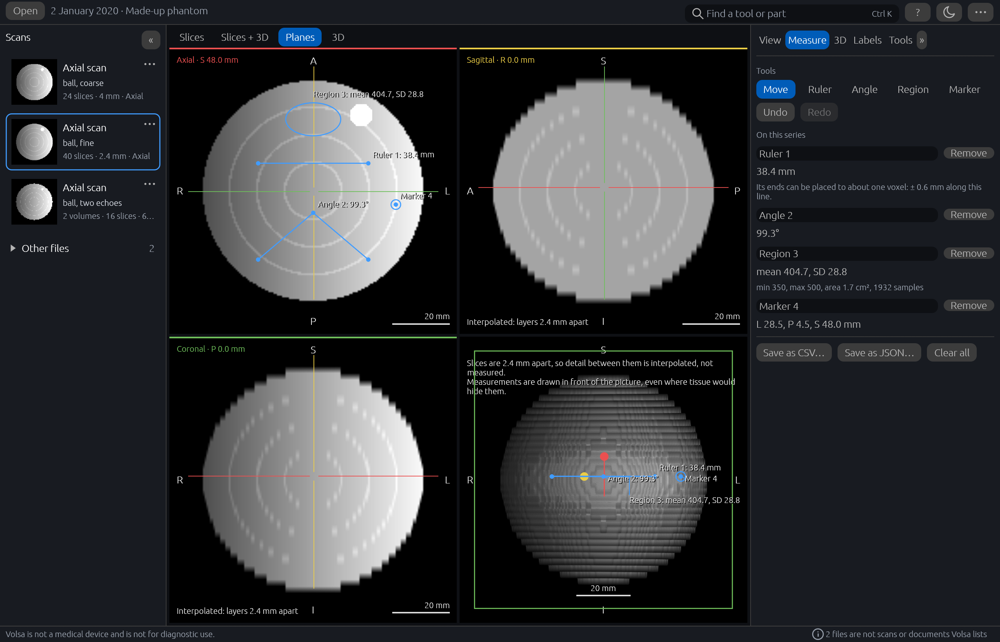

# Volsa

Volsa is a desktop viewer for MRI and CT scan exports, and other DICOM files at a basic level,
for 64-bit Windows. It opens a folder, a zip or a `DICOMDIR`, lists the studies and series inside
and says what kind each is. It shows a series as a stack of slices, as three planes through any
point of it, and as a volume in 3D that can be turned, cut open and saved as a picture; lengths,
angles and regions can be measured on it and points marked. It can also show the parts of a
brain that have been labelled, by another program or by a model Volsa runs on your own computer.
It makes no network connections.

**Volsa is not a medical device and is not for diagnostic use.** What it is for, and what it is
not for, is on the next page, [What Volsa is for](intended-use.md).

The picture shows a made-up study that Volsa's own example writes, not a scan of anyone.

## In this guide

- **Using Volsa**: [downloading and starting it](download-and-run.md), what it
  [needs](system-requirements.md), [a tour of the window](a-closer-look.md),
  [labelling a brain scan](labelling-a-brain-scan.md), [what it keeps on your
  computer](what-volsa-keeps-on-your-computer.md), [patient details and
  privacy](patient-details-and-privacy.md), [removing it](removing-volsa.md), and [getting help
  and reporting a fault](getting-help-and-reporting-a-fault.md).
- **About Volsa**: its [status](status.md), and its [licences and credits](licences-and-credits.md).
- **Working on Volsa**: [building it from source](building-from-source.md), and [trying it
  without a scan](trying-it-without-a-scan.md).

The magnifying glass at the top of each page, or the S key, searches the whole guide. The
program's code, its [changelog](https://github.com/Thenewmanator15/volsa/blob/main/CHANGELOG.md)
and its [security policy](https://github.com/Thenewmanator15/volsa/blob/main/SECURITY.md) are in
the [repository](https://github.com/Thenewmanator15/volsa).
