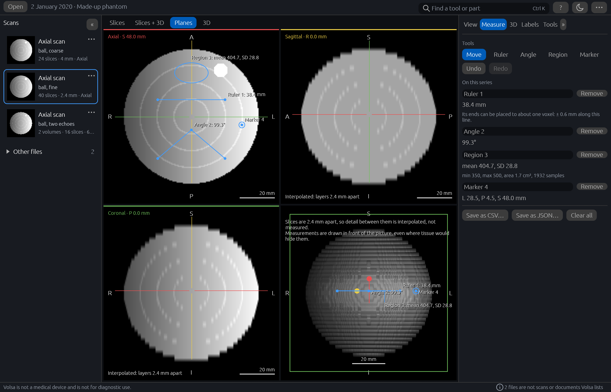
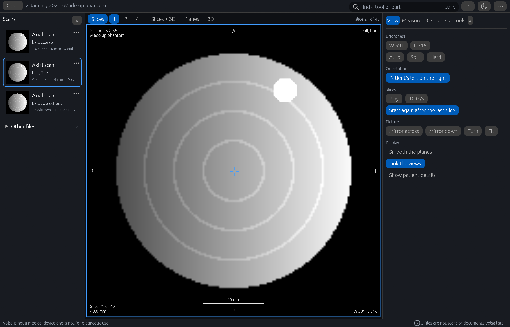
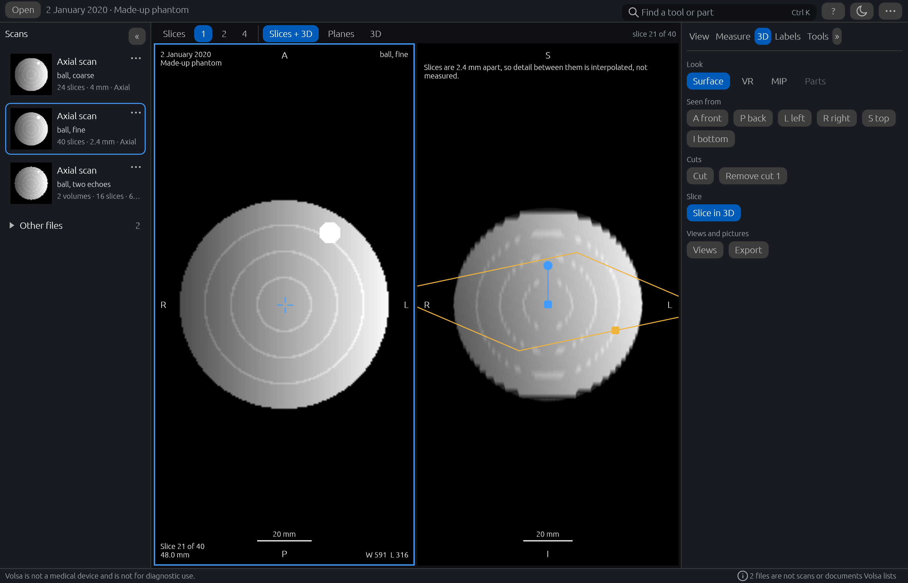
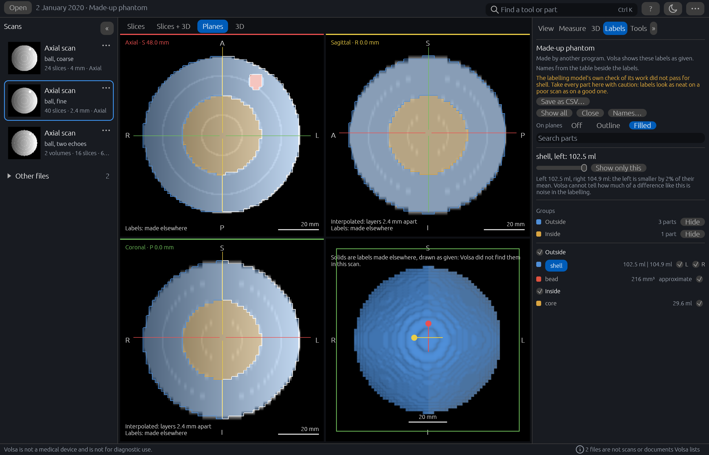
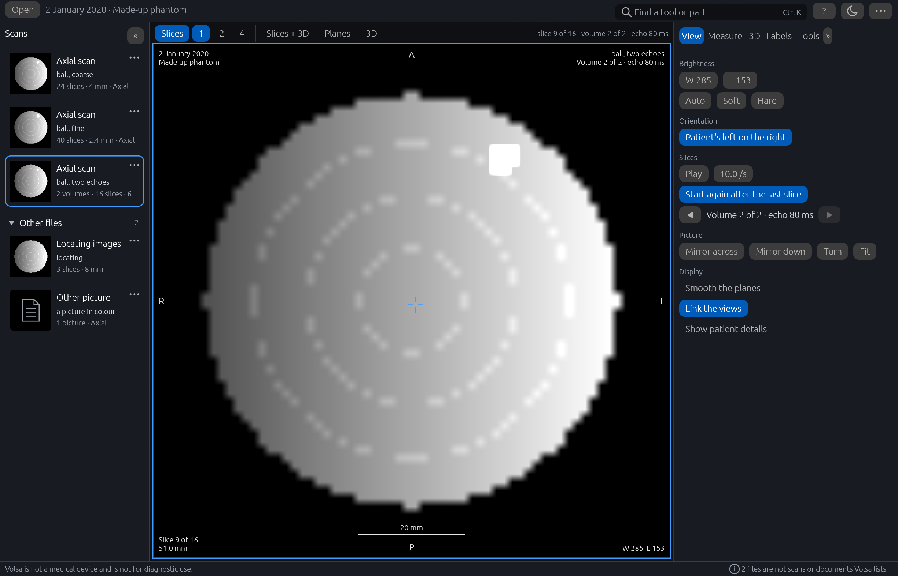

# A closer look

The pictures show a made-up study that Volsa's own example writes, not a scan of anyone (see
[[Trying it without a scan]]).

At the left, the rail of scans, a card for each; in the middle, **Planes**, a ball in its axial,
sagittal and coronal planes and in 3D, with a ruler, an angle, a region and a marker measured on
it; and at the right the **Measure** tab, listing those four with their values.

How Volsa opens an export: on the slices of the scan with the most detail (of the stacks of ten
or more slices, the one with the most voxels), here the finer of the two stacks of the ball,
with the **View** tab at the right holding brightness, orientation, playing through the slices,
and mirroring, turning and fitting the picture. The other scans are in the rail at the left,
and the search box at the top finds an action by its name.

The same ball turned and cut open in the 3D view, with **Slices + 3D** chosen so that a slice is
beside it and the slice drawn inside the 3D view. The **3D** tab at the right holds the looks,
the sides to see it from, the cuts and the saved views.

The same ball with the made-up labels that come with it, tinted over the three planes and drawn
as solids in 3D. The **Labels** tab at the right says first that another program made them,
with the check its table carries, which for this made-up table failed on the shell; then come
the groups and the list of its parts. The left half of its shell is selected, and the tab sets
it against the right half. The two halves were drawn equal: the 2% between them is where the
labels' own coarse voxels happen to fall, which is the kind of difference Volsa says it cannot
tell from noise.

An export holds more than plain stacks of slices, and the rail says what each is. Here the
made-up study also holds a series of two volumes of the ball, taken at two echo times, listed
once and shown on its second volume, as the strip above the pictures and the **View** tab say.
Under **Other files**, which a click opens, are three locating images in three planes and a
picture in colour. The card of the picture in colour, which a program saved and which could
carry words written on it, shows a page in place of its thumbnail while patient details are
off; the locating images keep theirs.

How to get round the window is on [[Download and run]].
